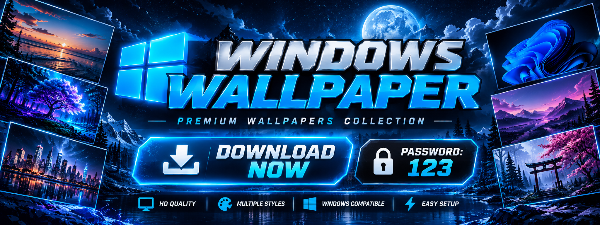

  

# 🪟 WALLPAPER WINDOWS FREE

### CUSTOMIZE YOUR WINDOWS EXPERIENCE

**ARCHIVE PASSWORD: `123`**

 

---

## 🖥️ WINDOWS DESKTOP COLLECTION

A wallpaper collection for users who want to personalize their Windows environment.

### ✨ COLLECTION HIGHLIGHTS

- 🖼️ Desktop background images
- 🎨 Multiple visual themes
- 🪟 Windows-oriented customization
- 📦 Convenient archive format

## ⚙️ HOW TO APPLY

1. Download the collection.
2. Extract the archive with password `123`.
3. Open Windows Settings.
4. Navigate to **Personalization → Background**.
5. Select the image you want to use.

## 📥 DOWNLOAD

**Password: `123`**

---

## ⚠️ DISCLAIMER

This project is an unofficial wallpaper collection and is not affiliated with Microsoft. Windows is a trademark of Microsoft Corporation. Use and review downloaded files responsibly.
